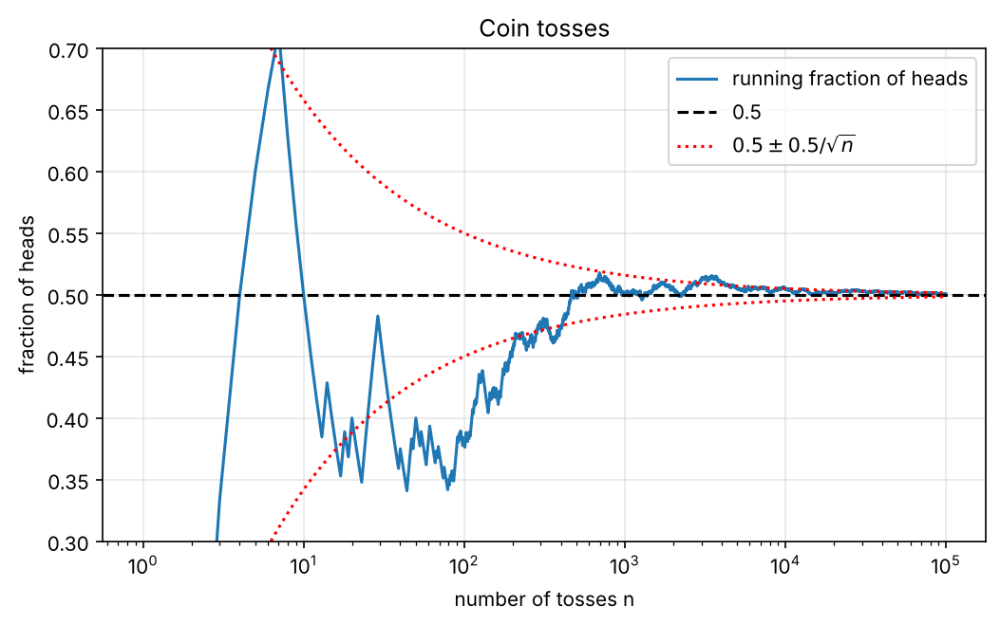
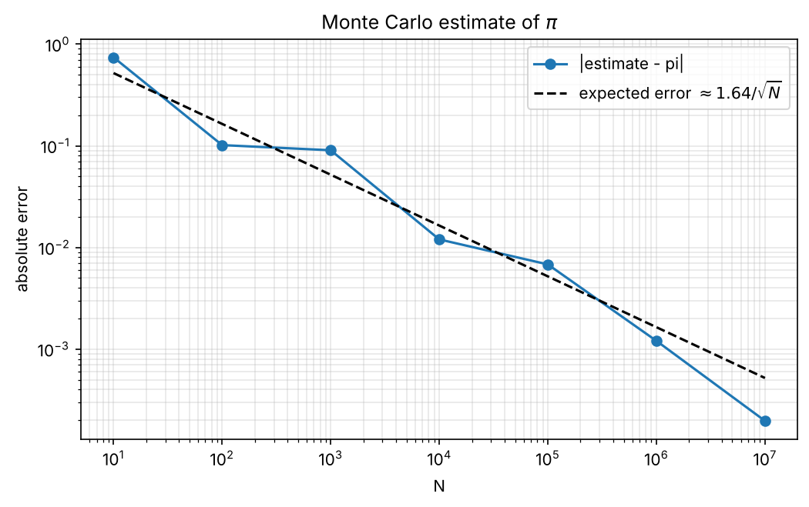
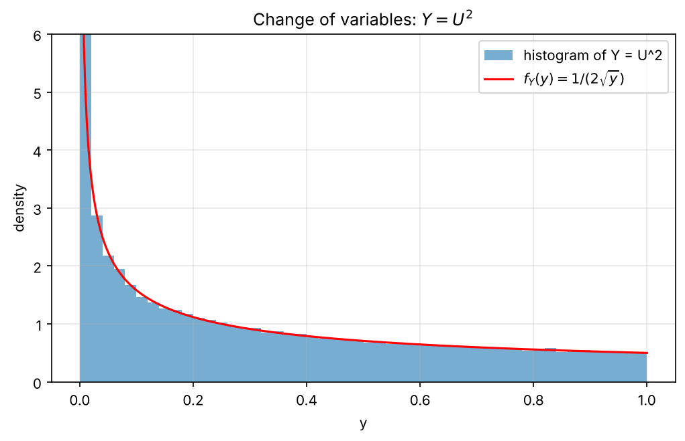
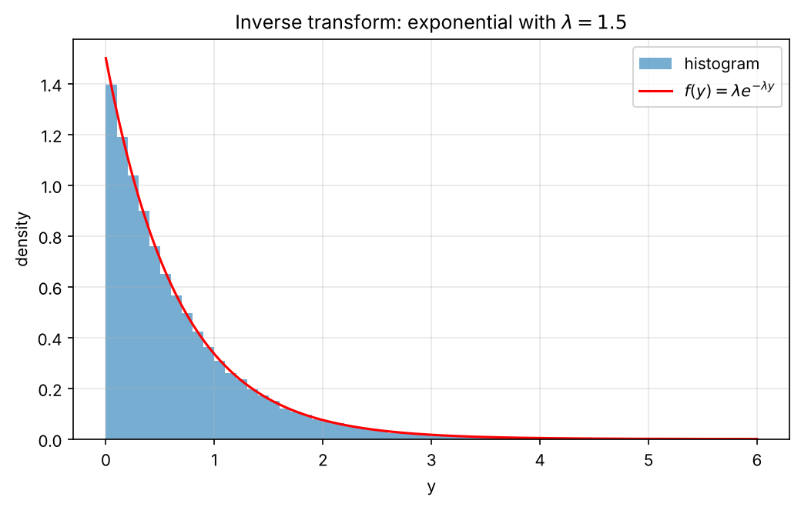
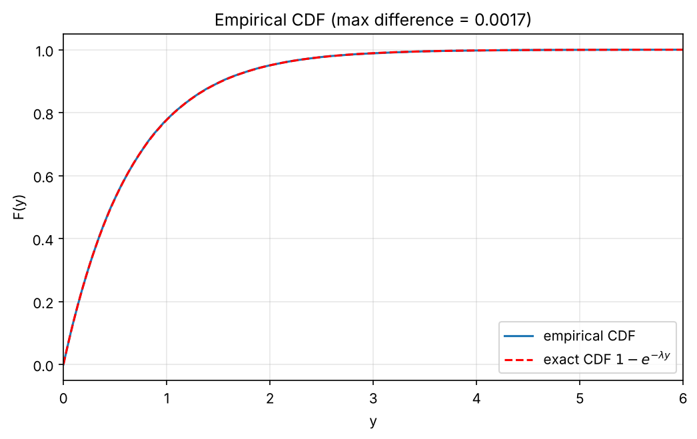

# Homework 07 – Random numbers and Monte Carlo

All the random numbers are generated in C (`hw7.c`) with the GSL random number generator (Mersenne Twister, `gsl_rng_mt19937`). The C program writes the data in `output/`, and `plots.py` makes the plots.

## How to run

You need GSL and Python with `numpy` and `matplotlib`.

```
make        # compiles hw7.c, runs it and makes the plots
make clean  # removes the executable and the output folder
```

The printed results are also saved in `output/run_log.txt`.

## 1. Coin tosses and the law of large numbers

I generate 100000 tosses: a toss is heads if `u < 0.5`, where `u` is uniform in [0, 1). After every toss I save the fraction of heads so far.

| n | fraction of heads |
|---|---|
| 10 | 0.50000 |
| 100 | 0.38000 |
| 1000 | 0.50000 |
| 10000 | 0.50520 |
| 100000 | 0.50048 |



At the beginning the fraction changes a lot (at n = 100 it is still 0.38), but then it gets closer and closer to 0.5, as the law of large numbers says. The distance from 0.5 goes down like $0.5/\sqrt{n}$ (the red lines): to get one more correct digit you need 100 times more tosses.

## 2. Monte Carlo estimate of π

I take random points $(x, y)$ in the unit square, with $x$ from one RNG stream and $y$ from a second, independent stream (same generator, different seed). The fraction of points with $x^2 + y^2 \le 1$ is about $\pi/4$, so $\pi \approx 4 \cdot (\text{points inside})/N$.

| N | estimate | error |
|---|---|---|
| 10 | 2.400000 | 7.4e-01 |
| 100 | 3.040000 | 1.0e-01 |
| 1000 | 3.232000 | 9.0e-02 |
| 10000 | 3.129600 | 1.2e-02 |
| 100000 | 3.148400 | 6.8e-03 |
| 1000000 | 3.140388 | 1.2e-03 |
| 10000000 | 3.141396 | 2.0e-04 |



The error decreases like $1/\sqrt{N}$: on the log-log plot the points follow a line with slope −1/2. Each point is inside with probability $p = \pi/4$, so the expected error is $4\sqrt{p(1-p)/N} = \sqrt{\pi(4-\pi)/N} \approx 1.64/\sqrt{N}$ (dashed line). The points are not exactly on the line because the error is itself random.

## 3. Change of variables: Y = U²

If $U$ is uniform in (0, 1), then $P(Y \le y) = P(U \le \sqrt{y}) = \sqrt{y}$, and the derivative gives $f_Y(y) = \frac{1}{2\sqrt{y}}$.



The histogram of 100000 samples follows the analytic density. Most values are close to 0, because squaring a number between 0 and 1 makes it smaller.

## 4. Inverse transform: exponential

The exponential CDF is $F(y) = 1 - e^{-\lambda y}$. Setting $F(y) = U$ and solving for $y$ gives $Y = -\ln(1-U)/\lambda$. I use $\lambda = 1.5$.



The histogram agrees with the PDF $\lambda e^{-\lambda y}$. As another check, the mean of the sample is 0.6664, very close to the expected $1/\lambda = 0.6667$.

## 5. Empirical CDF

To build the empirical CDF I sort the samples of exercise 4: the $i$-th sorted value gets $F = i/N$.



The empirical CDF is on top of the exact CDF $1 - e^{-\lambda y}$. The largest difference between the two is 0.0017, which is small for $N = 100000$ samples.
